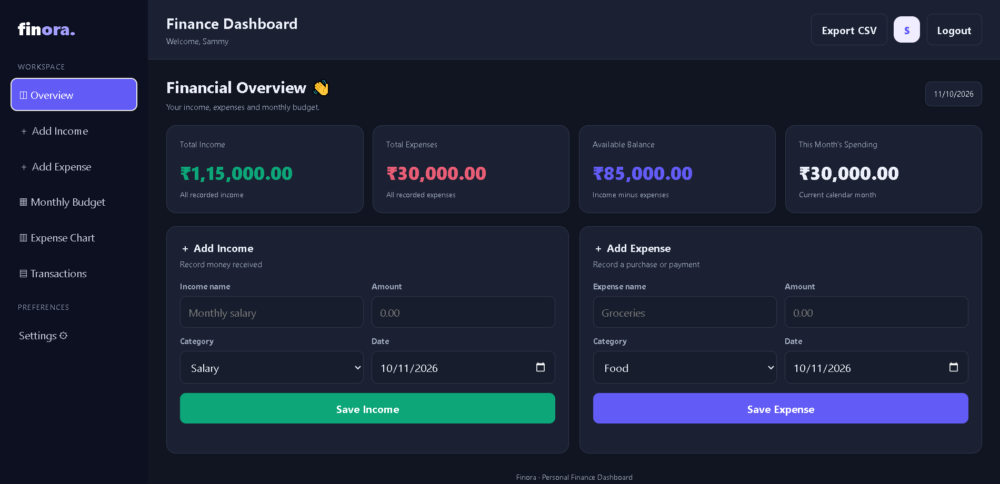

# 💰 Finora Expense Tracker

 HEAD
**A modern, responsive personal finance management application to track income, manage expenses, set monthly budgets, and understand your spending habits.**

<p align="center">
  <strong>Track smarter. Spend better. Stay in control.</strong>
</p>

## 📌 About the Project

Finora Expense Tracker is a web-based personal finance application designed to help users organize their daily finances in one place. It provides a dashboard for monitoring income, expenses, available balance, and monthly spending.

The application includes user authentication, transaction management, monthly budgeting, spending visualization, CSV export, and customizable interface settings.

## ✨ Features

- 🔐 **User Authentication** — Register, log in, and manage your account.
- 💵 **Income Management** — Record income with categories, amounts, and dates.
- 💸 **Expense Tracking** — Add, view, and delete expense records.
- 📊 **Financial Dashboard** — Monitor total income, total expenses, available balance, and current-month spending.
- 🎯 **Monthly Budget Management** — Set monthly budgets and track spending against your budget.
- 📈 **Spending Visualization** — View expense breakdowns by category.
- 🔎 **Transaction Search & Filtering** — Find transactions using search and category filters.
- 📥 **CSV Export** — Export income and expense records to a CSV file that can be opened in spreadsheet applications.
- 👤 **Profile Management** — Update your profile name and change your password.
- 🎨 **Customizable Settings** — Adjust theme, accent color, compact layout, language, currency, and date format.
- 📱 **Responsive Interface** — Use the application on desktop, tablet, and mobile screens.
- 🗄️ **SQLite Database** — Store financial records locally in a database file.

## 🛠️ Tech Stack

| Technology | Purpose |
|---|---|
| HTML5 | Application structure |
| CSS3 | Styling and responsive layout |
| JavaScript | Frontend interactions |
| Node.js | Server-side runtime |
| Express.js | Backend and API routes |
| SQLite | Database storage |
| better-sqlite3 | SQLite database integration |
| Git & GitHub | Version control and source hosting |

A simple, modern, and user-friendly expense tracking application designed to help users manage their personal finances, track expenses, and maintain better control over their spending.

## 🚀 Features

- 📊 Track and manage daily expenses
- 💵 Monitor personal spending
- 🗂️ Organize project files and application data
- 🔐 Environment-based configuration for sensitive information
- 📱 User-friendly interface
- 🗄️ SQLite database integration
- 🌐 Local server-based application

## 🖥️ Application Preview

Take a look at the Finora Expense Tracker dashboard.



 **Note:** To display the screenshot, save an actual screenshot of your application as `dashboard.png` inside the `screenshots` folder.

## 🛠️ Tech Stack

- **Frontend:** HTML, CSS, JavaScript
- **Backend:** Node.js
- **Server:** Express.js (if configured in the project)
- **Database:** SQLite
- **Version Control:** Git and GitHub
 1d5968c (Update README with project documentation and screenshot)

## 📂 Project Structure

```text
 HEAD
finora-expense-tracker/
├── public/
│   └── index.html

Expense Tracker/
├── public/
│   └── index.html
├── screenshots/
│   └── dashboard.png
 1d5968c (Update README with project documentation and screenshot)
├── server.js
├── package.json
├── package-lock.json
├── .gitignore
└── README.md
```

 HEAD
**Note:** The SQLite database file and generated session-secret file are created or maintained locally and are excluded from Git tracking.

## 🚀 Getting Started

Follow these instructions to run Finora Expense Tracker on your computer.

### Prerequisites

Install the following:

- [Node.js](https://nodejs.org/) — preferably an active LTS version
- npm — included with Node.js
- [Git](https://git-scm.com/) — optional, for cloning the repository

### 1. Clone the Repository

## ⚙️ Installation and Setup

### 1. Clone the repository
 1d5968c (Update README with project documentation and screenshot)

```bash
git clone https://github.com/soumadip-003/finora-expense-tracker.git
```

 HEAD
### 2. Open the Project Folder
### 2. Open the project folder
 1d5968c (Update README with project documentation and screenshot)

```bash
cd finora-expense-tracker
```

 HEAD
### 3. Install Dependencies

### 3. Install dependencies
 1d5968c (Update README with project documentation and screenshot)

```bash
npm install
```

 HEAD
### 4. Start the Application

### 4. Start the application
 1d5968c (Update README with project documentation and screenshot)

```bash
node server.js
```

 HEAD
### 5. Open in Your Browser

### 5. Open in your browser
 1d5968c (Update README with project documentation and screenshot)

Visit:

```text
http://localhost:3000
```

 HEAD
You can now register an account and start managing your finances.

> If you are running the project from an existing local folder, open the terminal in that folder before running the commands.

## 🔒 Security Notes

- Passwords are hashed using Node.js `crypto.scrypt`.
- Authenticated API routes are used to protect financial operations.
- Financial records are associated with user accounts.
- The application uses a session-signing secret for authentication tokens.
- Local database and session-secret files should not be committed to GitHub.
- For production deployment, configure a strong, persistent `SESSION_SECRET` through your hosting provider's environment variables.
- Use HTTPS and review authentication, cookie, database, backup, and deployment security before handling real financial information.

**Important:** This project is a personal finance management tool, not a bank or a financial advisory service.

## 🧑‍💻 Development

To make changes:

1. Update the frontend in `public/index.html` or backend in `server.js`.
2. Test the application locally.
3. Commit and push your changes to GitHub.

```bash
git add .
git commit -m "Update Finora Expense Tracker"
git push
```

## 🗺️ Future Improvements

Potential enhancements include:

- 📅 Advanced date-range reports
- 📊 Monthly and yearly financial analytics
- 🔔 Budget threshold notifications
- 📄 PDF report generation
- ☁️ Secure cloud database integration
- 🧪 Automated tests and continuous integration

> Make sure the server is running and the application uses port 3000. If your configuration specifies another port, use that port instead.

## 🔒 Security

- Sensitive environment variables should not be committed to GitHub.
- Local database files should be excluded from version control when they contain private data.
- The `.gitignore` file helps prevent accidental commits of sensitive files and dependencies.

## 🔮 Future Improvements

- Expense categories and advanced filtering
- Monthly and yearly expense reports
- Interactive charts and visual analytics
- Budget planning and spending limits
- Export reports to CSV or PDF
- Improved mobile responsiveness
 1d5968c (Update README with project documentation and screenshot)

## 👨‍💻 Author

**Soumadip Sikder**

GitHub: [@soumadip-003](https://github.com/soumadip-003)

 HEAD
## 📦 Repository

[View Finora Expense Tracker on GitHub](https://github.com/soumadip-003/finora-expense-tracker)

## 📄 License

No license has been specified yet. Unless a license is added to this repository, reuse and redistribution are subject to the default copyright rules.

---

<p align="center">
  <strong>Finora Expense Tracker</strong><br>
  <em>Take control of your money, one transaction at a time.</em>
</p>

## 📌 Repository

[Finora Expense Tracker on GitHub](https://github.com/soumadip-003/finora-expense-tracker)

---

⭐ If you find this project useful, consider giving the repository a star!
 1d5968c (Update README with project documentation and screenshot)


<!-- git add README.md screenshots/dashboard.png
git rebase --continue -